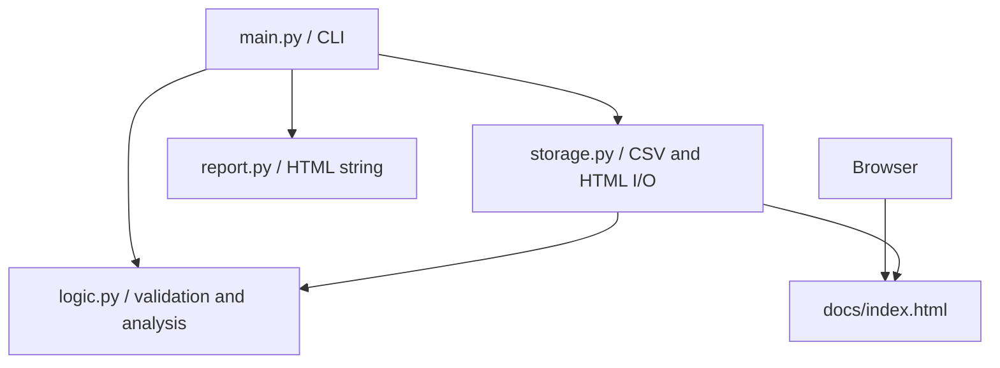
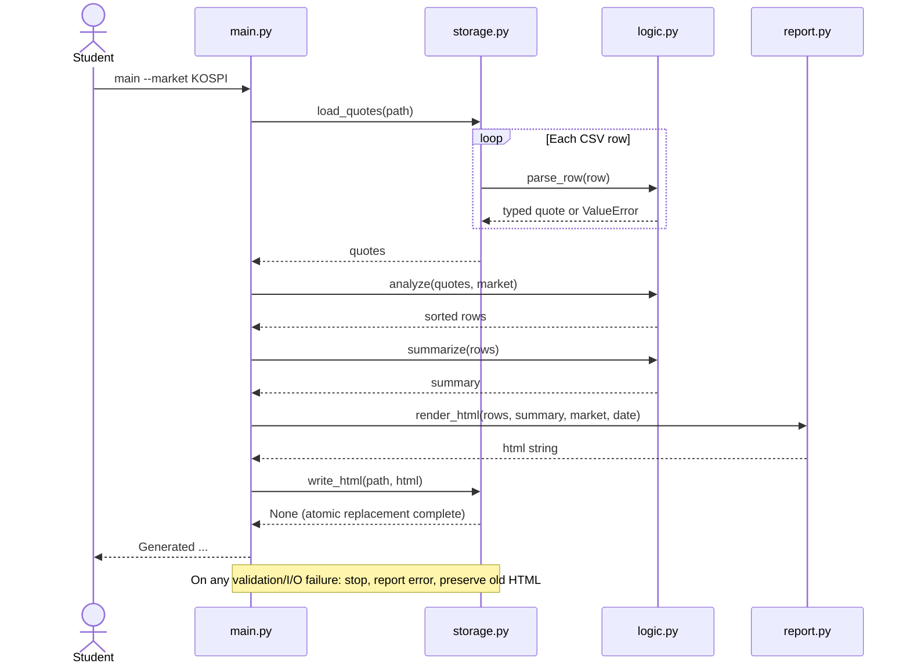
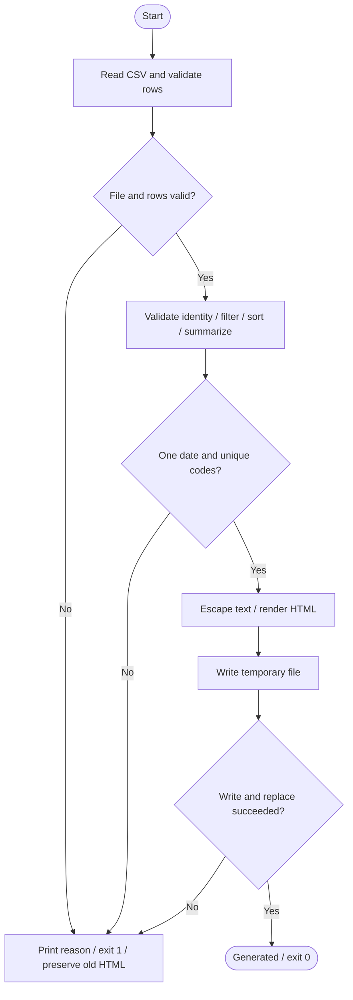

# 한국 증권시장 분석 웹페이지: 설계에서 MVP까지

## 0. 첨부 양식으로 보는 같은 설계

- [사용자 시나리오 작성 예시](../../labs/session2/team-name_user-scenario.md): SC-01 정상 분석, SC-02 잘못된 입력, SC-03 빈 데이터, 아키텍처와 1인 역할 분담.
- [명세 워크북 작성 예시](../../labs/session2/team-name_spec.xlsx): Instructions / Requirement / Feature / Function / Test의 원래 구조를 유지해 작성.
- 아래 설명은 두 첨부 문서와 같은 프로젝트다. SC → REQ → FEAT → FUNC → TEST를 연결하며 UML은 함수명과 호출 순서를 보여준다.
- 워크북은 요구사항 8개(Must 6 + 미구현 확장 2), 기능 3개, 함수 8개, 테스트 13개(자동 12 + 수동 1)를 담는다. 항목 수와 구현 완료 건수는 다르다.

| Scenario | 내용 | 관련 REQ |
|---|---|---|
| SC-01 | ALL/KOSPI 표본 분석과 보고서 열람 | REQ-01~05; REQ-07/08은 후속 아이디어 |
| SC-02 | 전일종가 0 거부, 기존 HTML 보존 | REQ-02/06 |
| SC-03 | 정상 헤더만 있는 CSV의 빈 보고서 | REQ-01/04/05 |

## 1. 시나리오와 범위

학생 민지는 장 마감 후 KOSPI·KOSDAQ 종목 일부의 변화를 비교하고 싶다. CSV 파일을 준비하고 `python3 main.py --market ALL`을 실행한다. 프로그램은 전일종가 대비 등락률을 계산하고 등락률 내림차순 표와 표본 요약을 `docs/index.html`에 만든다. 민지는 브라우저에서 기준일·시장·종목별 종가·등락률·거래량을 확인한다. KOSDAQ만 보고 싶으면 `--market KOSDAQ`으로 다시 생성한다.

오류 시나리오: 전일종가가 0인 행을 전달하면 행 번호가 포함된 오류를 출력한다. 종료 코드 1이며 기존 HTML은 바뀌지 않는다. 빈 CSV(정상 헤더만 있음)는 종목 0개, 평균 N/A, 빈 상태 안내를 표시한다. 입력 파일을 찾지 못하면 빈 데이터로 가장하지 않고 오류로 종료한다.

이 프로젝트는 단일 날짜의 **수업용 가상 표본**을 분석한다. 전 종목 시장 분석, 실시간 데이터 수집, 지수 계산, 투자 추천은 범위에 포함하지 않는다. 화면과 CSV 기준일을 연결하고 출처·가상 데이터 표시를 유지한다. 기간 수익률, 이동평균, 로그인, 차트, 클릭 필터, API 연동은 Should/Could로 남긴다.

## 2. 요구사항 (Requirement)

| ID | 조건 | 우선순위 | 수락 기준 |
|---|---|---|---|
| REQ-01 | CSV에서 단일 날짜의 종목을 정확히 읽고 코드를 문자열로 보존한다 | Must | TEST-01/12: 005930 유지, 한글/BOM 처리, 헤더 검증 |
| REQ-02 | 잘못된 가격·거래량·코드·날짜·시장, 중복코드·날짜 혼합을 거부한다 | Must | TEST-03/07/09: 실패, 기존 HTML 불변 |
| REQ-03 | 일간 등락률을 계산하고 ALL/KOSPI/KOSDAQ 필터와 결정적 정렬을 제공한다 | Must | TEST-02/04: 70000→71400은 +2%, 동률은 코드 오름차순 |
| REQ-04 | 표본 수, 상승·하락·보합, 단순평균을 계산한다 | Must | TEST-05/06: 5, 2/2/1, +0.40%; 빈 평균은 N/A |
| REQ-05 | 한글 HTML에 기준일·시장·출처·단위·표·빈 상태를 보여준다 | Must | TEST-08/11/13 + 브라우저 확인: 코드, 종가 원, 거래량 주, 부호와 소수 2자리 |
| REQ-06 | 입력/출력 오류를 알리고 실패 시 기존 보고서를 보존한다 | Must | TEST-09/10: 오류 종료, 이전 파일 유지, 임시 파일 정리 |
| REQ-07 | 화면에서 시장을 클릭해 전환한다 | Should | 후속 작업; MVP는 CLI 재생성 |
| REQ-08 | 실제 API·기간 분석·차트를 추가한다 | Could | 데이터 출처·호출 제한·가격 조정 규칙을 먼저 설계 |

수락 예시는 가상 CSV에 고정된다. 공개된 실제 시세와 비교하는 테스트가 아니다.

## 3. Feature 명세

### FEAT-01: 검증된 스냅샷 불러오기 (REQ-01/02/06)

- 사용자: CSV를 준비한 학생. 명령: `python3 main.py --input data/prices.csv`.
- 정상: 파일 열기 → 헤더 검증 → 각 행 검증/타입 변환 → 한 날짜·중복코드 확인.
- 결과: 코드가 문자열인 종목 목록. 이 결과는 FEAT-02로 전달된다.
- 오류: 파일 없음/권한/인코딩/행 형식 오류는 `Report not generated: <reason>`. 기존 보고서 유지. 행 오류에는 CSV 행 번호 포함.

### FEAT-02: 시장별 분석 (REQ-02/03/04)

- 명령: `python3 main.py --market KOSPI`. 허용: ALL(기본), KOSPI, KOSDAQ.
- 계산: `(close - previous_close) / previous_close * 100`. 계산·정렬 중에는 반올림하지 않는다.
- 정상: 입력 전체의 날짜·중복을 검증 → 시장 필터 → 등락률 내림차순/코드 오름차순 → 표본 요약.
- 결과: KOSPI 표본 3개, 순서 005930→035420→000660, 평균 +0.33% 표시.
- 예외: 알 수 없는 시장은 argparse 사용 오류(종료 2). 선택 결과가 비면 0개·N/A.

### FEAT-03: 웹 보고서 생성·열람 (REQ-05/06)

- 명령: `python3 main.py --output docs/index.html`; 브라우저로 생성 파일을 연다.
- 정상: HTML 문자열 생성 → 임시 파일 쓰기 → 최종 파일 교체 → Generated 메시지.
- 결과: 표와 요약, 기준일·출처·가상 데이터 표시. 상승/하락 색상과 함께 +/− 부호를 사용한다.
- 오류: 출력 실패 시 `Report not generated: ...`, 종료 1. 기존 출력 보존.
- 외부 텍스트는 HTML escape한다. 네트워크 접속 없이 동작한다.

FEAT-01 PR → FEAT-02 PR → FEAT-03 PR 순서로 구현한다. 각 PR은 간단한 화면 출력 또는 임시 HTML까지 이어지는 실행 가능한 슬라이스로 제출한다. FEAT-01 단계의 분석/HTML fake는 명확히 표시하고 마지막 PR 전에 모두 교체한다.

## 4. Function 계약

| 함수 / 모듈 | 입력 → 결과 | 실패·부작용 / 호출자 |
|---|---|---|
| FUNC-01 `parse_row(row)` / logic | 7개 문자열 필드 dict → 정수 가격·거래량을 가진 새 dict | ValueError; 순수 / load_quotes |
| FUNC-02 `load_quotes(path)` / storage | CSV 경로 → 검증한 quote 목록; 헤더만 있으면 [] | OSError, ValueError, UnicodeError; 읽기 / main |
| FUNC-03 `change_pct(previous_close, close)` / logic | 양의 가격 → 반올림 전 float % | 0 이하 ValueError; 순수 / analyze |
| FUNC-04 `analyze(quotes, market)` / logic | parse_row를 통과한 목록, 시장 → change_pct를 더한 새 정렬 목록 | 시장/중복/날짜 혼합 ValueError; 순수 / main |
| FUNC-05 `summarize(rows)` / logic | 분석 목록 → count/up/down/flat/mean dict | 빈 mean은 None; 순수 / main |
| FUNC-06 `render_html(rows, summary, market, snapshot_date)` / report | 검증된 분석 결과 → 완전한 HTML str | 텍스트 escape, 화면에서만 반올림; 순수 / main |
| FUNC-07 `write_html(path, html)` / storage | 경로, HTML str → None | OSError; 폴더 생성·임시 쓰기·원자적 교체 / main |
| FUNC-08 `main(argv=None)` / main | CLI 인자 → 종료 코드 0 또는 1 | argparse는 사용 오류 2; 출력·조립 |

Quote: `{date: str, code: str, name: str, market: str, previous_close: int, close: int, volume: int}`. 분석 행은 `change_pct: float` 추가. Summary는 정수 count/up/down/flat와 float 또는 None인 mean. 가격 단위는 원, 거래량은 주다. parse_row만 문자열을 숫자로 바꾼다. main과 storage가 I/O를 맡고 logic/report는 문자열·자료구조만 다룬다.

## 5. Test 명세와 추적

실행: 예제 폴더에서 `python3 -m unittest -v`. 파일 I/O 테스트는 TemporaryDirectory를 사용해 실제 배포 결과를 건드리지 않는다.

| TEST | 입력·상황 | 기대 결과 | REQ | 구현 메서드 |
|---|---|---|---|---|
| TEST-01 | 기본 CSV | 005930 문자열, 종가 int | 01 | test_01_schema_and_leading_zero |
| TEST-02 | 70000/71400, 200000/198000, 100/100 | +2%, -1%, 0% | 03 | test_02_changes |
| TEST-03 | 0/음수/NaN 가격, 음수·소수 거래량, 잘못된 날짜·코드·시장·빈 이름 | ValueError | 02 | test_03_reject_invalid_fields |
| TEST-04 | KOSPI 필터와 동률 두 행 | 3개·내림차순, 동률 코드 오름차순, 원본 불변 | 03 | test_04_filter_and_sort |
| TEST-05 | ALL 가상 표본 | count 5, up 2, down 2, flat 1, mean 0.4 | 04 | test_05_sample_summary |
| TEST-06 | 빈 입력 또는 선택 결과 | 0개, mean None, HTML N/A·빈 안내 | 04/05 | test_06_empty_data |
| TEST-07 | 중복코드 또는 날짜 혼합 | ValueError | 02 | test_07_snapshot_identity |
| TEST-08 | 종목명에 script 태그 | 실행 태그 없음, escape 문자·005930·+2.00%·71,400 표시 | 05 | test_08_html_escape |
| TEST-09 | 누락 CSV, 잘못된 헤더 | 종료 1, 기존 HTML OLD 유지 | 01/02/06 | test_09_missing_and_bad_csv_preserve_report |
| TEST-10 | os.replace 오류 주입 | 기존 파일 유지, 임시 파일 제거 | 06 | test_10_atomic_write_failure |
| TEST-11 | main KOSPI 실행 | HTML 존재, 삼성전자 포함, KOSDAQ 종목 제외 | 05 | test_11_end_to_end |
| TEST-12 | BOM·헤더만, 부족/초과 필드 | [] 또는 ValueError | 01/02 | test_12_csv_boundaries |

**TEST-13 (수동, Not run):** 브라우저 수락 테스트: 로컬 서버를 열고 제목·한글·기준일·시장·출처, 표의 다섯 종목, 부호·색상, 좁은 화면 가로 스크롤, 빈 상태를 확인한다. 서버는 저장된 HTML을 제공할 뿐 Python 분석을 다시 수행하지 않는다. 직접 확인 후에만 워크북 Actual result와 Pass status를 갱신한다.

추적 예: REQ-03 → FEAT-02 → FUNC-03 change_pct / FUNC-04 analyze → 아래 시퀀스의 analyze 호출 → TEST-02/04. REQ-06 → FEAT-01/03 → load_quotes/write_html/main → 활동도의 오류 분기 → TEST-09/10.

## 6. UML

### Use case (텍스트 UML)

```text
Actor: Student
System boundary: Korean Market Report
Student --> (Load a validated snapshot)      FEAT-01
Student --> (Compare stocks by market)      FEAT-02
Student --> (Generate and view web report)   FEAT-03
Actor: Browser (opens generated HTML)
```

### Component 관계



위 그림은 모듈 의존성과 산출물 관계를 보여준다. 아래 시퀀스에서 실제 호출 순서를 구분한다.

### Sequence: 정상 실행과 실패



### Activity: 실패 경로 포함



빈 목록은 정상 분석 경로를 따라 빈 HTML을 생성한다. Missing file은 오류 경로다. UML의 함수명은 계약 표와 실제 코드의 이름을 사용한다.

## 7. MVP 완료 기준

- 새 폴더에서 Python 표준 라이브러리만으로 테스트 12개 통과.
- ALL/KOSPI/KOSDAQ 명령과 빈 데이터·오류 시나리오를 재현 가능.
- docs/index.html을 브라우저에서 열고 가상 데이터·기준일·출처와 결과를 확인.
- 분석 코드에 input/print/open이 없고, 출력 실패가 기존 HTML을 훼손하지 않음.
- 요구사항·Feature·Function·Test·UML·README가 같은 이름·정렬·오류 정책을 사용.
- Must 기능에 fake/TODO 없음. PR에 REQ/FEAT ID, 테스트 결과, 화면 캡처 첨부.
